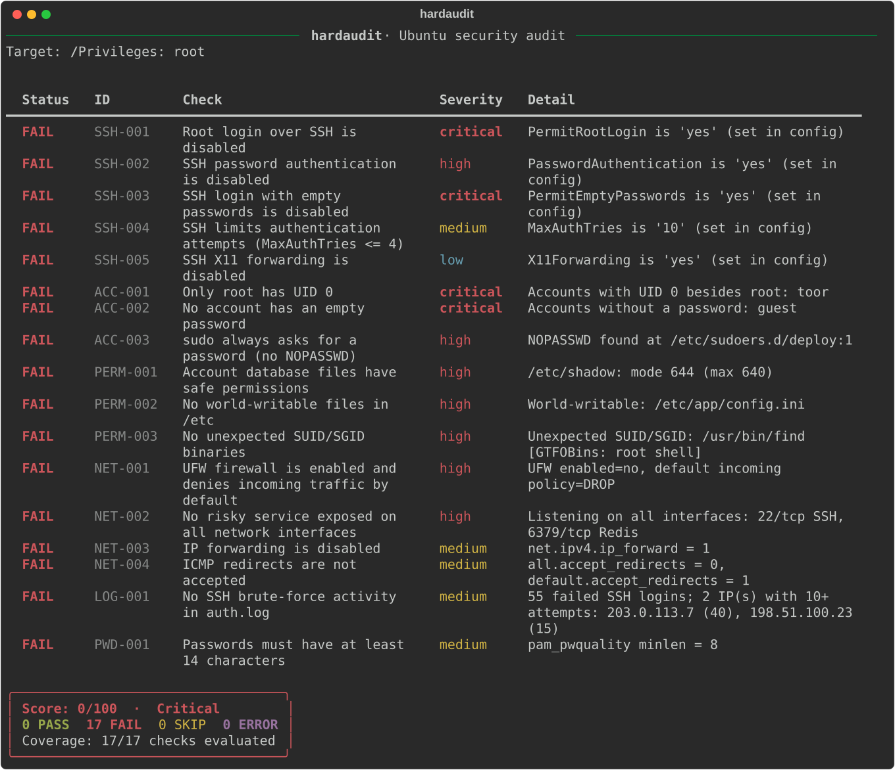
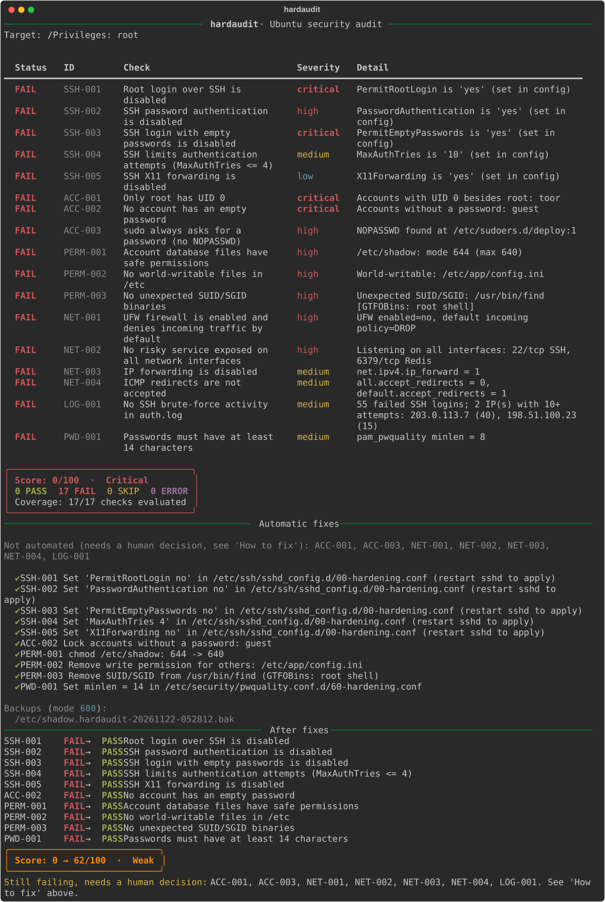

# ubuntu-hardening-auditor

[](https://github.com/MiguelVin/ubuntu-hardening-auditor/actions/workflows/ci.yml)


Ferramenta de linha de comando em Python que audita a segurança de um Ubuntu, dá uma **nota de risco de 0 a 100**, explica cada problema e **corrige automaticamente o que é seguro corrigir**.



## O problema

Um Ubuntu recém-instalado ou administrado às pressas costuma ter configurações que facilitam um ataque: SSH aceitando login de root, firewall desligado, arquivos de senha legíveis por qualquer usuário, programas que viram shell de root. Verificar tudo isso à mão é lento e fácil de esquecer.

## A solução

- **17 checagens** em 6 áreas: SSH, contas, permissões, rede, logs e política de senha
- **Nota ponderada por severidade**: uma falha crítica pesa mais que várias baixas, e a cobertura aparece junto da nota
- **Comando de correção** para cada falha, com avisos (ex.: "teste o login por chave antes, ou você perde o acesso")
- **`--fix`**: correção automática com backup, validação e confirmação
- **Relatórios** em HTML, Markdown e JSON (exemplo: [`docs/sample-report.html`](docs/sample-report.html), baixe e abra no navegador)
- **Lab Docker** com um Ubuntu propositalmente vulnerável para testar tudo sem risco

## Correção automática, mas só do que é seguro



No lab, o `--fix` leva a nota de **0 para 62** e **se recusa a corrigir 7 problemas sozinho**. Isso é de propósito:

| Corrige automaticamente | Deixa para uma pessoa decidir | Por quê |
|---|---|---|
| Configurações do SSH | Conta extra com UID 0 | Apagar uma conta exige investigar antes |
| Conta sem senha (bloqueia) | `NOPASSWD` no sudoers | Um sudoers quebrado tira o sudo de todo mundo |
| Permissões de `/etc/shadow` e afins | Firewall desligado | Ligar sem liberar o SSH corta o acesso remoto |
| Arquivos com escrita para todos em `/etc` | Serviço exposto | Pará-lo pode derrubar uma aplicação |
| SUID em binários do GTFOBins | IP forwarding / ICMP redirects | Mexe em roteamento, Docker e VPN |
| Tamanho mínimo de senha | Brute force no `auth.log` | É evidência de ataque: investigar, não só bloquear |

Proteções do `--fix`:
- `--dry-run` mostra o plano sem mudar nada; sem `--yes`, sempre pede confirmação
- Backup de cada arquivo antes da primeira alteração, **sempre com modo 600** (o backup de um `/etc/shadow` exposto não pode vazar as hashes de novo)
- Configuração do SSH validada com `sshd -t`; se for inválida, a alteração é desfeita
- Idempotente: rodar de novo não muda nada

## Conceitos aplicados

| Área | Conceito |
|---|---|
| SSH | No `sshd_config`, **o primeiro valor vence**: por isso a correção vai num drop-in `00-hardening.conf`, lido antes dos outros |
| Contas | O Linux dá poder de root pelo **UID**, não pelo nome; campo vazio no `/etc/shadow` = login sem senha |
| Permissões | Modo octal (`640`), bits **SUID/SGID** e escalada de privilégio via [GTFOBins](https://gtfobins.github.io/) |
| Rede | Sockets lidos direto do `/proc/net/tcp` (a mesma fonte do `ss`); `0.0.0.0` = exposto em todas as interfaces |
| Senhas | Tamanho mínimo via `pam_pwquality`, seguindo o **NIST SP 800-63B** (comprimento em vez de troca forçada) |
| Mapeamento | Cada checagem aponta as técnicas do **MITRE ATT&CK** que ela ajuda a prevenir |

## Como rodar

Requisitos: Ubuntu (ou WSL) com Python 3.11+.

```bash
git clone https://github.com/MiguelVin/ubuntu-hardening-auditor.git
cd ubuntu-hardening-auditor
python3 -m venv .venv
.venv/bin/pip install -e .

.venv/bin/hardaudit                     # auditoria como usuário comum (algumas checagens são puladas)
sudo .venv/bin/hardaudit                # auditoria completa
sudo .venv/bin/hardaudit -o reports/    # também salva report.html, report.md e report.json
.venv/bin/hardaudit --fix --dry-run     # mostra o que seria corrigido
sudo .venv/bin/hardaudit --fix          # corrige (pede confirmação)
```

Outras opções: `--format json|markdown`, `--group ssh` (só um grupo), `--root /caminho` (audita um sistema de arquivos montado), `--screenshot saida.svg`, `--no-hints`.

Código de saída: `0` tudo aprovado, `1` alguma falha, `2` o `--fix` precisa de root. Útil em pipelines de CI.

## Laboratório Docker

```bash
bash lab/demo.sh                               # sobe o lab, audita, corrige e salva os relatórios em lab/reports/
docker compose -f lab/docker-compose.yml down  # desliga o lab
```

O container é **propositalmente inseguro** (SSH com root e senha vazia, backdoor UID 0, `find` com SUID, "Redis" exposto, brute force simulado no `auth.log` com IPs de documentação da RFC 5737) e **não publica nenhuma porta**: nada fica acessível pela sua rede.

## Qualidade

- 69 testes com `pytest`: cada checagem e cada correção roda contra um "Ubuntu falso" numa pasta temporária, graças à opção `--root`
- Lint e formatação com `ruff`
- CI no GitHub Actions: testes em Python 3.11, 3.12 e 3.13 e um job que sobe o lab e confirma que o `--fix` melhora a nota

## Estrutura

```
src/hardaudit/
├── checks/      # ssh, accounts, permissions, network, logs, passwords
├── fix/         # plano de correção, fixers e backups
├── reports/     # terminal, HTML, Markdown, JSON
├── sshd.py      # parser do sshd_config (Include, Match, primeiro valor vence)
├── score.py     # nota ponderada por severidade
└── cli.py
lab/             # Ubuntu vulnerável em Docker + demo
tests/
```

## Tecnologias

Python · Rich · Jinja2 · pytest · ruff · Docker · GitHub Actions · Linux (PAM, sshd, UFW, /proc)

## Lições aprendidas

- **Testar num sistema real encontra o que o teste unitário não encontra**: no Ubuntu 26.04 a ferramenta acusou o `/usr/bin/sudo.ws` como SUID suspeito. Era uma mudança recente da distribuição (o `sudo` virou `sudo-rs`, escrito em Rust, e o clássico passou a se chamar `sudo.ws`).
- **Uma nota alta sobre poucas checagens não prova nada**: a primeira versão dava 100/100 avaliando só 1 de 8 itens. Agora a cobertura aparece junto da nota.
- **Automatizar correções exige saber quando NÃO automatizar.**

## Próximos passos

- Ler logs do `journald` (sistemas sem `/var/log/auth.log`)
- Referenciar a seção do CIS Ubuntu Benchmark em cada checagem
- Checagens de serviços (`systemd`), atualizações pendentes e AppArmor

## Autor

**MiguelVin** · Estudante de Engenharia da Computação · [GitHub](https://github.com/MiguelVin)

> Ferramenta para fins educacionais. Use apenas em sistemas próprios ou com autorização explícita. Revise cada comando antes de executá-lo.
